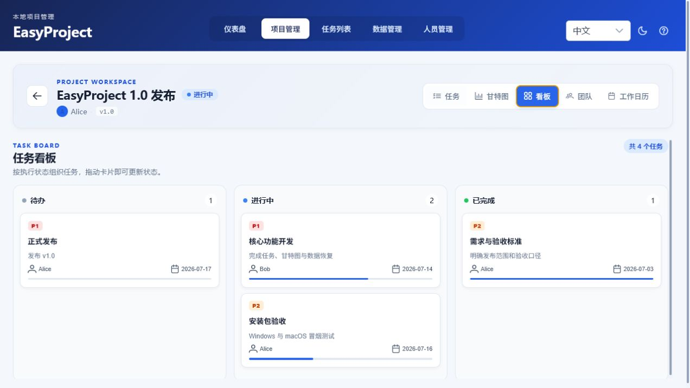
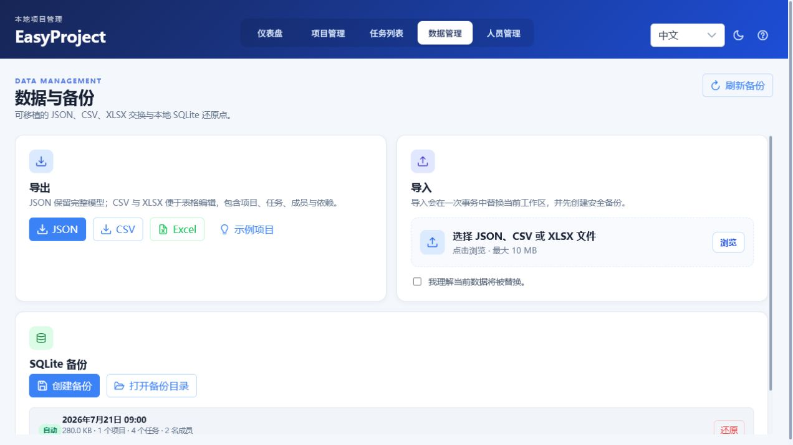
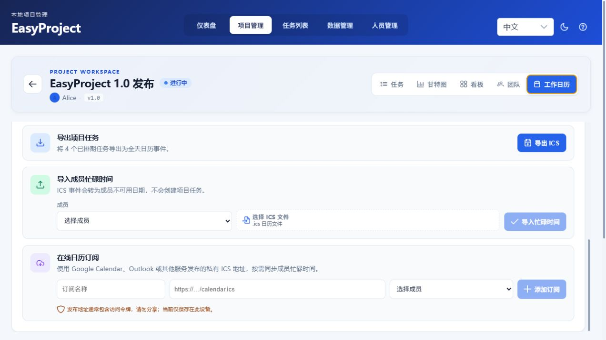

# EasyProject

2026-10-27本轮任务列表整改已完成并交付桌面、网页/后端及独立MCP。350单测、110界面、13真实HTTP与真实桌面深浅/窄窗复验通过，窄窗筛选文字换行问题已修复；新受限副本及原文件/数据库保全通过。现有MCP客户端需重连，公开下载包和正式生产验收结论不变。精确版本、完整验证及局限见[本轮交付记录](docs/TASK_LIST_UI_REFINEMENT_CHECKPOINT.md)。

2026-10-27任务列表整改已安全更新桌面与网页/后端：项目内和全局共用统计/筛选/抽屉，隐藏零计数、图标切换统计维度、整体折叠、清晰字典染色及卡片筛选；新增未选色状态由共享服务随机配色并保存，不批量重写旧色。110界面/13真实HTTP及1280真实桌面深浅验证通过；独立MCP替换等待具体占用连接停止许可，原生窄窗检查待补，不宣称整轮全部完成。公开下载仍为既有版本，详见[本轮准确状态](docs/TASK_LIST_UI_REFINEMENT_CHECKPOINT.md)。

2026-10-27已交付规范中/英/西三语入口与组件本地化、官网邮件反馈li_you_mu@126.com及共享默认状态三语别名防重。桌面、网页/后端和独立MCP已按70ad16e安全更新并核验原数据保全；正式生产验收仍未通过，公开下载包保持既有v0.1.2-beta.1。精确产物、副本、测试及原生未验边界见[交付记录](docs/I18N_SPANISH_CHECKPOINT.md)。

2026-10-26当前线上已完成手动版本检查、最新合成截图及官网下载分组，公开桌面包仍为既有v0.1.2-beta.1（并非下文历史“暂无公开包”）。西班牙语及规范国际化、官网反馈邮箱li_you_mu@126.com正在候选验证，尚未上线；见[国际化约定](docs/INTERNATIONALIZATION.md)与[准确续接状态](docs/I18N_SPANISH_CHECKPOINT.md)。正式生产验收结论不变。

[产品官网 / Product homepage](https://home-host.tail2956dd.ts.net/) · [进入在线版 / Open web app](https://home-host.tail2956dd.ts.net/index.html#/dashboard)

2026-10-22 homepage delivery: the bilingual, responsive product page is live on the existing server. Explicit `/index.html` and historical `/#/...` workspace links remain compatible. Desktop installers are not publicly distributed yet; local offline use, data isolation and MCP permissions are unchanged. See [deployment evidence and limitations](docs/LANDING_PAGE_CHECKPOINT.md).

2026-10-22 public trial: the owner explicitly enabled Tailscale Funnel for the existing HTTPS application endpoint. Only the application is exposed; SSH/database access stays private, and local offline use is unchanged. Basic public-relay reachability and anonymous-access checks passed, but shared authentication rate limits, storage quotas and wider-network acceptance remain open. See [the public-access checkpoint](docs/FUNNEL_PUBLIC_ACCESS_CHECKPOINT.md); this is not production-release acceptance.

2026-10-22 private deployment: account profiles, 6–31-character passwords, protected password recovery and full-ID schema migrations are installed on the desktop and private server. “Forgot password” is a small link below the password field, aligned right. The independent MCP was updated; reconnect Codex to load it. See the [delivery checkpoint](docs/ACCOUNT_PROFILE_DATABASE_CHECKPOINT.md) for protected backups and remaining verification boundaries. Public production release remains unapproved.

2026-10-22 candidate: circular account avatars with square upload preview and automatic crop/compression, editable login usernames, opt-in Windows-protected password saving, 6–31-character passwords and administrator-issued one-time password recovery. Account schema3 and business schema6 retain separate databases and use full semantic-prefix UUID IDs. See [database design](docs/DATABASE_DESIGN.md) and [implementation/deployment checkpoint](docs/ACCOUNT_PROFILE_DATABASE_CHECKPOINT.md) before upgrading; old independent MCP executables must not be used with schema6.

Account settings and MCP access are available from the toolbar avatar menu. Refreshing after a remote workspace conflict reloads data without signing out; only a genuinely expired or revoked session requires login again. One-time MCP secrets use a separate read-only copy dialog.

EasyProject is an open-source, local-first desktop project planning application. It combines structured task planning, dependency-aware scheduling, execution views, portable data exchange, and local recovery without requiring an account.

The [authenticated web workspace](server/README.md) reuses the same Rust domain services. Desktop launches at sign-in, with an explicit **Use locally without signing in** option that works offline. Local and remote workspaces remain separate: no automatic upload, merge, or error fallback. Deployment, dedicated service account and startup commands: [current checkpoint](docs/DESKTOP_LOGIN_SERVICE_CHECKPOINT.md).

Open registration creates ordinary accounts with isolated workspaces. Signed-in users can generate scoped, expiring and revocable personal tokens for remote MCP CRUD. This private deployment does not enable public Internet access or replace local stdio MCP. Delivery and remaining acceptance boundaries: [signup and MCP checkpoint](docs/OPEN_SIGNUP_MCP_TOKEN_CHECKPOINT.md).



<details>
<summary>More screenshots</summary>





</details>

## Current capabilities

- Create, edit, archive, and soft-delete projects.
- Start from blank, software-release, marketing-campaign, or writing templates; generated tasks are scheduled on the project work calendar with dependencies intact.
- Create and maintain tasks with dates, status, priority, assignee, parent, and project association; assignees must be active members of the project team.
- Track task progress and finish-to-start dependencies with cycle prevention.
- Plan in a linked daily Gantt view with task bars, milestones, progress, and dependency lines.
- Switch each project between task list, Gantt, board, team, and work-calendar views.
- Drag board cards between To do, In progress, and Done; completed cards automatically reach 100%.
- Export and import schema-v5 JSON, CSV, or formatted XLSX workbooks with mapping previews, including plan baselines and model relationships.
- Export project tasks as ICS and import external busy events into member availability.
- Subscribe to private published Google Calendar, Outlook, or other ICS URLs for on-demand busy-time sync.
- Undo and redo the last 30 data-changing actions in local desktop mode with `Ctrl+Z` and `Ctrl+Y`; remote whole-workspace undo is disabled to protect changes from other devices.
- Create and inspect local SQLite backups. Startup and periodic automatic snapshots retain the latest 10 copies; imports and restores create safety backups.
- Store SQLite and backups in `<installation>/data` by default. On Windows, C-drive storage is rejected; no silent AppData fallback is used.
- Choose a new/empty non-C local data directory in the Data page. Changes take effect on restart, copying and verifying the latest database, backups and MCP audit while retaining the source. Window profiles use `<installation>/webview`; settings use `<installation>/easyproject-storage.json`. Install into a writable non-C location; uninstalling must preserve these user files.
- Automatically discover the old production AppData database only for the initial migration. Debug builds do not import production data. Update independent MCP clients to the database path displayed in the Data page after a move.
- Validate editable fields in the Rust service layer.
- Restrict remote calendar targets, backup restore paths, WebView content sources, and production log verbosity.
- Use the top-right **任务悬浮窗 / Task floating window** button to open an independent read-only task window for progress and project navigation (requires the updated desktop build).
- Drag floating-window edges to resize (minimum 340×360; task cards scroll without hiding controls). Collapse to a floating ball: click to reopen, drag near any screen work-area edge to dock, or leave it in the middle to float freely. Arrow keys move the focused ball; the bottom-right resize grip supports arrow keys. Expanded size is retained while the window stays open.
- Docked balls reveal a half-circle at the screen edge; hover or keyboard focus pops out the full circle, then retracts when leaving. Free-floating balls stay whole, and reduced-motion preferences disable the transition.
- The task window opens expanded and lists the five nearest dated unfinished tasks (including overdue and Todo tasks), with project, due date and progress. Background refresh preserves existing content; no current-task selection is required.
- Task creation/editing uses a responsive PrimeVue dialog with a separate draft and reachable Save/Cancel actions; editing does not alter visible table columns.
- View consistently aligned page borders and statistic cards. Task names stay pinned while optional columns scroll; choose visible columns, hover truncated values for full text, and clear parent/predecessor selections.
- Connect a trusted local MCP client to project/task/member CRUD and project-team tools; opt-in write/delete permissions, recovery points, and client approval protect mutations. See the [MCP guide](docs/MCP.md).

## Technology

- Vue 3, Vite, and PrimeVue
- Tauri 2 and Rust
- SQLite through `rusqlite`

## Development

Requirements: Node.js, npm, Rust 1.90 or newer, and the platform prerequisites for Tauri 2.

```bash
npm install
npm run tauri:dev
```

Useful checks:

```bash
npm run lint
npm run typecheck
npm test
npm run test:e2e
npm run build
npm run release:check
cd src-tauri
cargo check
cargo clippy --all-targets --locked -- -D warnings
cargo test --locked
```

## Project documentation

- API contracts and private Apifox maintenance: [`docs/api/README.md`](docs/api/README.md) (MCP stdio and desktop IPC, not an HTTP service).

- New maintainer/AI handoff (rules, architecture, current state, onboarding): [`docs/handoff/README.md`](docs/handoff/README.md)
- Local MCP setup, permissions, contracts, and limits: [`docs/MCP.md`](docs/MCP.md)
- Product and implementation plan: [`docs/PROJECT_PLAN.md`](docs/PROJECT_PLAN.md)
- v0.1 release audit and remaining risks: [`docs/AUDIT_2026-08-08.md`](docs/AUDIT_2026-08-08.md)
- Current code audit and remediation standard: [`docs/audit/UNIVERSAL_PROJECT_AUDIT_STANDARD.md`](docs/audit/UNIVERSAL_PROJECT_AUDIT_STANDARD.md) (UPARS 1.1.0)
- Release and platform smoke tests: [`docs/RELEASING.md`](docs/RELEASING.md)
- Application icon source, generation, and Windows validation: [`docs/ICON_DESIGN.md`](docs/ICON_DESIGN.md)
- Draft v0.1.0 release notes: [`docs/RELEASE_NOTES_0.1.0.md`](docs/RELEASE_NOTES_0.1.0.md)
- Example import snapshot: [`public/examples/easy-project-example.json`](public/examples/easy-project-example.json)
- The Wolai Project page remains the collaborative source for product scope, linked feature databases, models, and milestones.

## Delivery roadmap

1. M0–M3 — local MVP, project/task workspace, Gantt planning, and data recovery. Complete.
2. M4–M8 — unified experience, members, resource load, baselines, and dependency enhancements. Complete.
3. M9 — performance, automated tests, quality gates, packaging, and first public release. In progress.

## Desktop releases

The release workflow creates unsigned Windows x64 MSI/NSIS installers and macOS Apple Silicon/Intel APP and DMG bundles. See [`docs/RELEASING.md`](docs/RELEASING.md) for versioning, artifact validation, and signing requirements.

## Data safety

Project data is stored locally in the operating system application-data directory. Use the Data view to inspect recovery-point contents, create manual backups, open the backup directory, exchange complete snapshots, or restore an earlier SQLite backup. Restore validates the source first and creates a rollback point before replacing current data.

SQLite backup restore requires the current schema-v5 format and all required tables. Older exchange snapshots can still be imported through the versioned JSON importer after validation.

The native exchange format is currently schema v5. Imports from v1 through v5 are accepted; invalid relationships or failed replacements roll back without changing the current workspace.

Published calendar URLs commonly contain secret access tokens. EasyProject stores subscription settings only on the current device; treat those URLs as passwords and revoke them at the provider if exposed. OAuth account access and two-way event editing are intentionally outside the current release.

## Contributing and license

Contributions are welcome. See [`CONTRIBUTING.md`](CONTRIBUTING.md) for quality gates and development expectations. EasyProject is licensed under the [MIT License](LICENSE).
